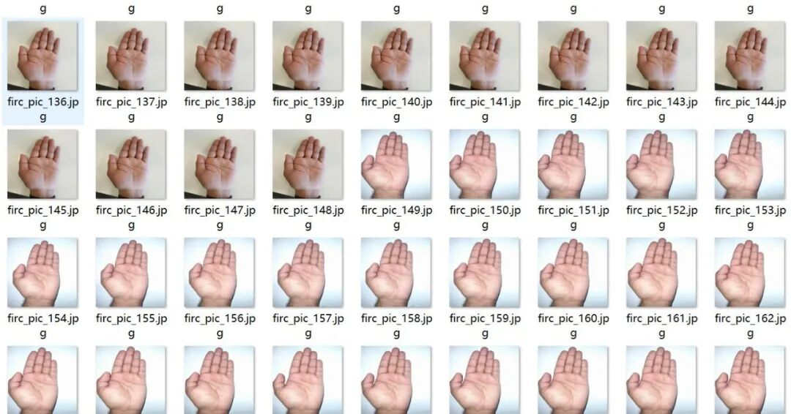
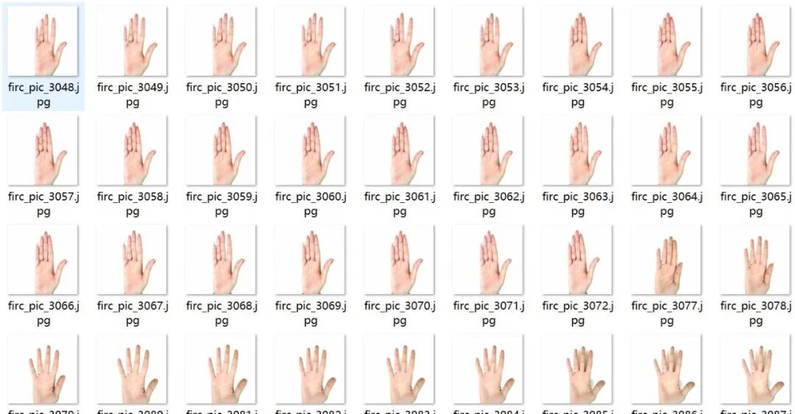
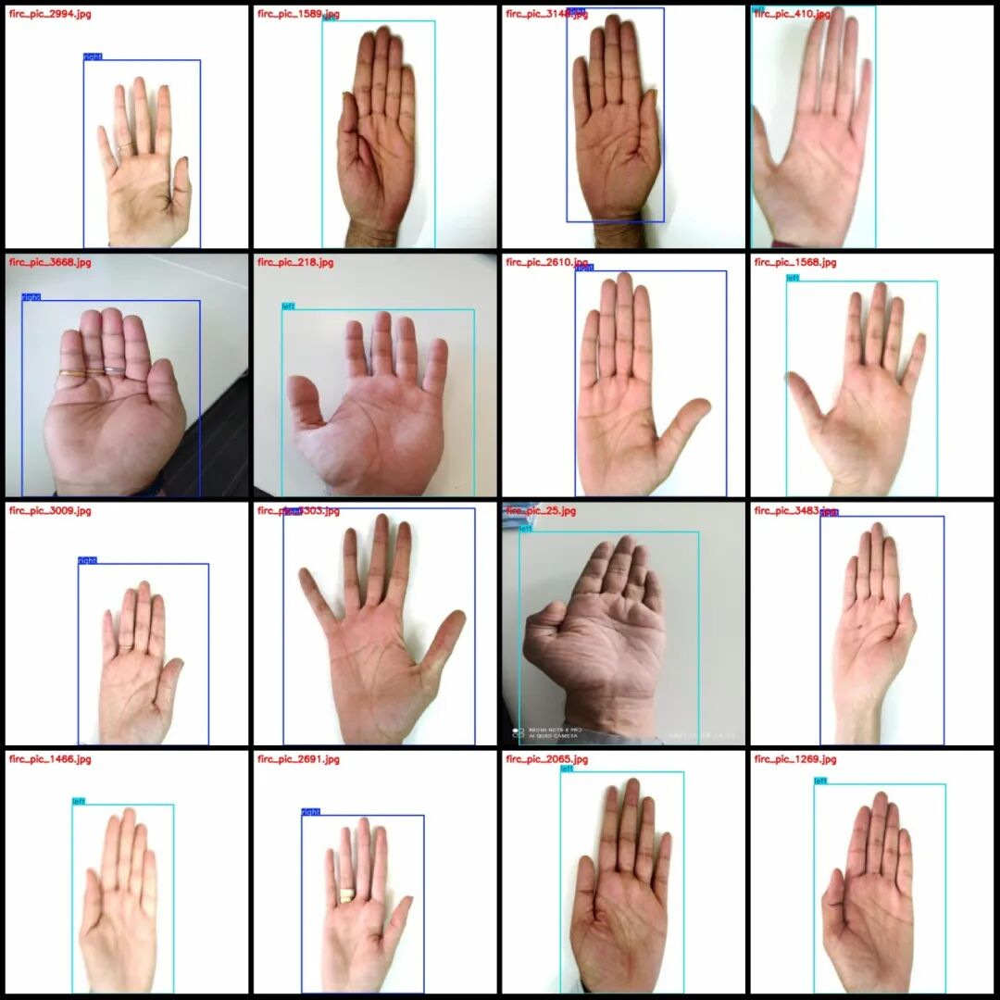
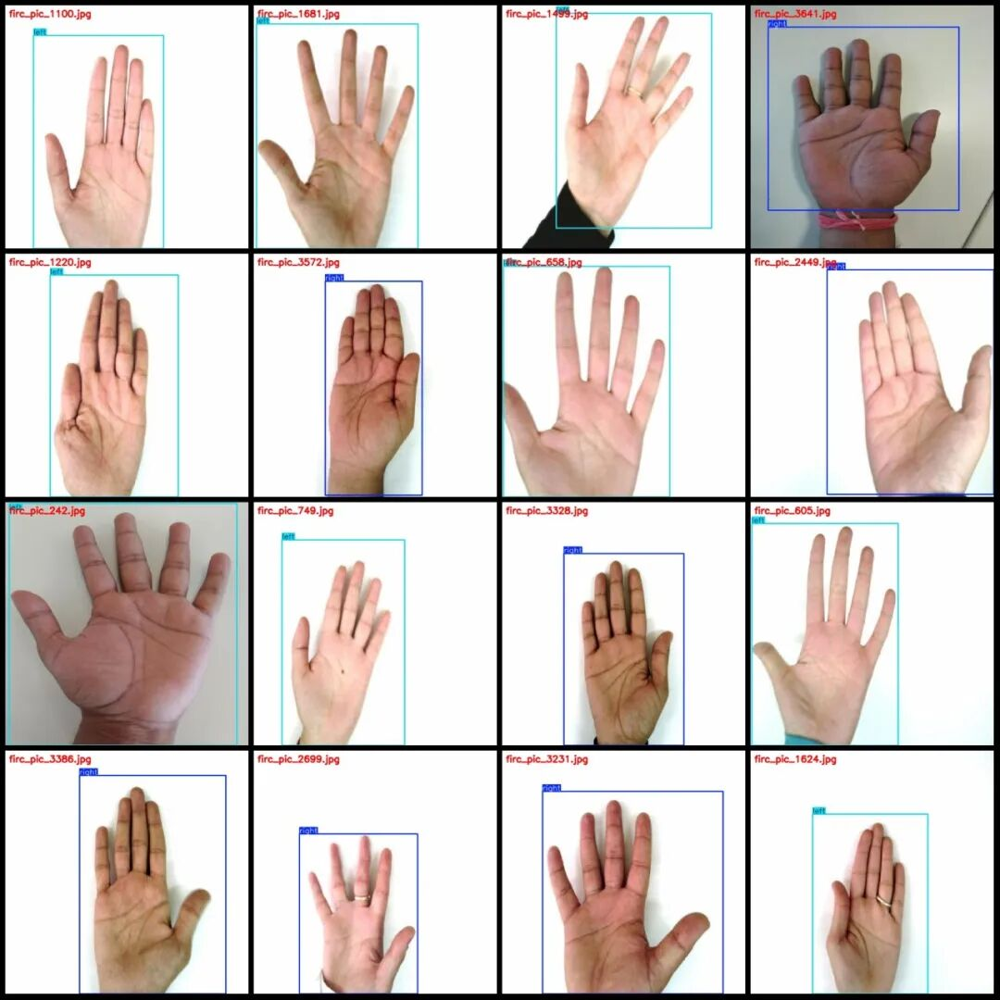
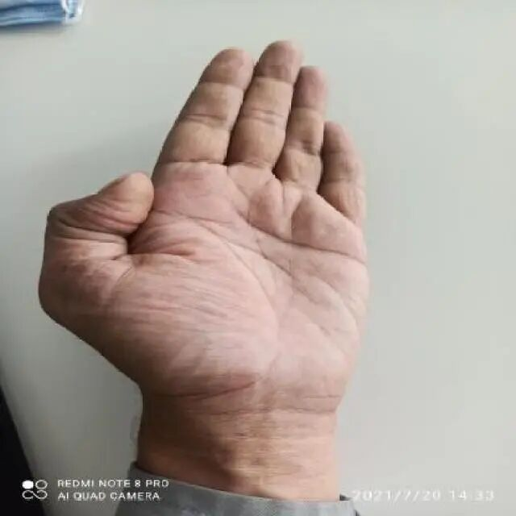
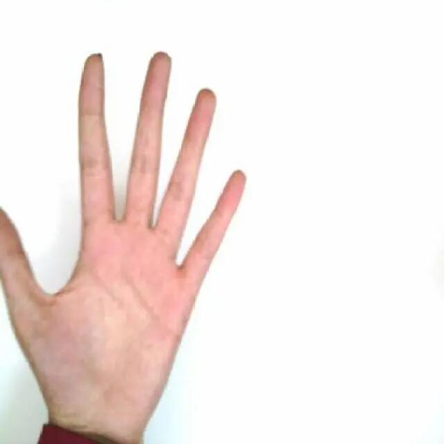
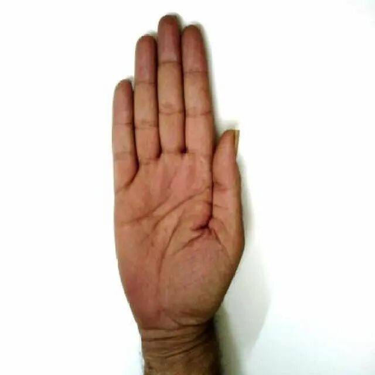

# Indoor Biometric Feature Collection - Detection of the Right and Left Palms in VOC+YOLO format with 3739 images in 2 categories

Note: The images in the dataset are formed by extracting frames from multiple videos, so there may be many "duplicate" images. Please refer to the images for specific details.

Dataset format: Pascal VOC format + YOLO format (txt file without split path, only containing jpg images and corresponding VOC format xml files and yolo format txt files)

Number of images (number of jpg files): 3739

Number of annotations (number of xml files): 3739

Number of annotations (number of txt files): 3739

Labeling category count: 2

Label category names (note that the order of categories in the YOLO format does not correspond to this, but is based on the labels folder's classes.txt): ["left", "right"]

Number of boxes and the number of images occupied by each category:

Left Frame Count = 2340, Image Count = 2336

Right box count = 1416, occupying image count = 1403

Total frame count: 3756

Image resolution: 640x640

Using labelImg:

Annotation rules: Draw a rectangle around the category.

Important Notice: The dataset does not have separate training, validation, and test sets; you need to partition them yourself.

Special : This dataset does not guarantee the accuracy of the trained models or weight files.

Image Preview:

Annotation example:

Single image:

## Payment

Here is a pay link on Stripe ( https://buy.stripe.com/3cs8yP7sY87d0vu9AB ). Please contact me lonlonago@foxmail.com after funding $89, and I will send you a complete data files , thank you!

